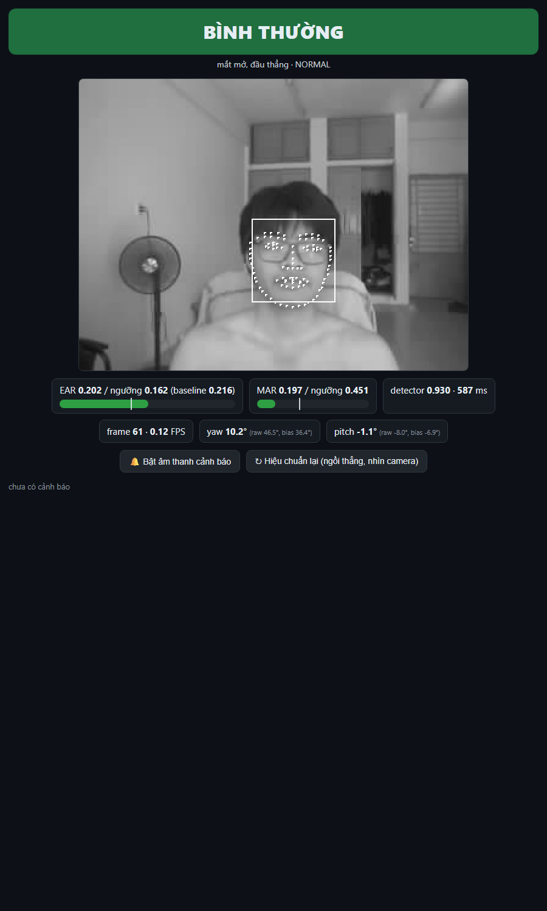

# Project 13 — Phát hiện tài xế buồn ngủ / mất tập trung trên ESP32-S3

Hệ thống nhúng chạy **hoàn toàn trên ESP32-S3** (không cần laptop): camera OV5640 → phát hiện mặt →
98 điểm khuôn mặt → tính **EAR/MAR/góc đầu** → máy trạng thái ADAS → cảnh báo, kèm **web server** để
xem trực tiếp trên điện thoại trong cùng mạng Wi-Fi.



*Ảnh chụp thật từ board (14/11/2026): banner trạng thái, ảnh khung hình có **khung ROI + 98 điểm** do
ESP32 tự vẽ, thanh EAR/MAR so với ngưỡng đã hiệu chuẩn, và các nút **bật âm thanh** / **hiệu chuẩn lại**.*

---

## 1. Tính năng

| Chức năng | Cách hoạt động |
|---|---|
| Phát hiện khuôn mặt | **BlazeFace short-range INT8** (TFLite Micro), 896 anchor, NMS IoU 0,3 |
| 98 điểm khuôn mặt | **PIPNet-98 (ResNet18) INT8** (ESP-DL), nạp từ flash partition 12 MB |
| Buồn ngủ | EAR (mắt) + luật **ngưỡng tương đối** `0,75 × baseline` của chính tài xế, cần **2 mẫu nhắm trong 3 mẫu** |
| Ngáp | MAR = (cao môi ngoài + cao môi trong) / (2 × rộng miệng), ngưỡng `1,6 × trung vị` lúc hiệu chuẩn |
| Mất tập trung | PnP 3D head pose → |yaw − bias| > 25° hoặc |pitch − bias| > 30° |
| Hiệu chuẩn | 4–10 mẫu đầu tiên khi có mặt: lấy trung vị EAR/MAR và bias pose; có nút **hiệu chuẩn lại** trên web |
| Quan sát | Wi-Fi STA + HTTP: `/`, `/status` (JSON), `/snapshot.bmp`, `POST /recalib` |

## 2. Thông số đã đo (không phải ước lượng)

| Hạng mục | Số đo | Nguồn |
|---|---|---|
| Tốc độ | **541 ms** (detector) + **7.526 ms** (PIPNet) → **8,2 s/khung ≈ 0,12 FPS** | 426 lần detect + 64 lần PIPNet trong log |
| PIPNet chi tiết | preprocess 10,4 ms · `model.run()` 7.477 ms · decode 39,2 ms | log `[LM split]` |
| Độ chính xác (ESP32 vs laptop, cùng ảnh+cùng ROI) | 98 điểm lệch **0,24 px trung vị** (p95 0,90), box IoU **0,936**, EAR lệch **0,0036** | 32 ảnh / 30 người |
| Đa người trên thiết bị | **12/12** khung người khác (8 tài xế YawDD + 4 người mắt nhắm CEW), score 0,704–0,970 | ảnh nhúng trong firmware |
| Nghiệm thu người thật | nhắm mắt → **MICROSLEEP ALARM**; quay đầu → **DISTRACTION**; 0 panic/WDT | `serial_accept3.log` |
| Bộ nhớ | SRAM trống 173–293 KB; PSRAM trống 3,7–5,5 MB | log khởi động |

## 3. Nạp từ repo (không cần build)

```powershell
# 1) cắm board, đóng Serial Monitor
powershell -ExecutionPolicy Bypass -File tools\flash_release.ps1 -Port COM3

# 2) xem log (115200)
$py='C:\Espressif\python_env\idf5.3_py3.11_env\Scripts\python.exe'
& $py tools\watch_live.py --port COM3

# 3) mở trình duyệt/điện thoại cùng Wi-Fi theo IP in ra trong log, ví dụ
#    http://192.168.1.5/
```

`flash_release.ps1` kiểm **SHA-256** của cả 4 file trước khi ghi (bootloader, phân vùng, app, model
PIPNet). Lần đầu dùng đủ 4 phần; các lần sau chỉ cần app: thêm `-AppOnly`.

**Wi-Fi:** điền SSID/mật khẩu vào `firmware_esp32/main/wifi_secret.h` rồi build lại.
File này **bị gitignore**, không bao giờ được commit (xem `.gitignore`).

## 4. Build lại từ mã nguồn

```powershell
# ESP-IDF 5.3.5
$env:IDF_PATH='C:\Espressif\frameworks\esp-idf-v5.3.5'
$py='C:\Espressif\python_env\idf5.3_py3.11_env\Scripts\python.exe'
& $py $env:IDF_PATH\tools\idf.py -C firmware_esp32 -D SDKCONFIG="$PWD\firmware_esp32\sdkconfig" build
```

Lần build đầu cần mạng để `idf.py` tải `managed_components/` (không lưu trong repo).

## 5. Cấu trúc repo

```
firmware_esp32/main/     nguồn firmware: main.cpp (pipeline), blaze_tracker.cpp (BlazeFace/TFLM),
                         face_espdl.cpp (PIPNet-98), adas_controller.cpp (FSM), obs_server.cpp (web),
                         camera_capture.cpp, image_decoder.cpp, pnp_solver.cpp
firmware_esp32/partitions.csv   factory 3,08 MB + pipnet 12 MB + blaze 1 MB
release/                 BẢN CHẠY ĐƯỢC: bootloader, partition-table, app.bin, pipnet_partition.bin
tools/                   công cụ đo/kiểm: watch_live, serial_capture, flash_release, replay test,
                         benchmark đa người, so sánh ESP32↔laptop, vẽ đồ thị nghiệm thu
docs/                    báo cáo cuối + nhật ký kỹ thuật + checklist demo + ảnh minh chứng
```

## 6. Tài liệu

| File | Nội dung |
|---|---|
| [docs/PROJECT13_FINAL_REPORT_20261114.md](docs/PROJECT13_FINAL_REPORT_20261114.md) | **Báo cáo cuối**: phiên bản model + hash, kiến trúc, độ chính xác, tốc độ, giới hạn, cách chạy |
| [docs/BLAZE_IQ_RESULT_20261113.md](docs/BLAZE_IQ_RESULT_20261113.md) | Nhật ký kỹ thuật đầy đủ (mục 1–18b): từng lỗi, từng phép đo, từng hướng đã thử |
| [docs/DEMO_CHECKLIST_PIPNET_20261113.md](docs/DEMO_CHECKLIST_PIPNET_20261113.md) | Kịch bản demo 7 bước, xử lý sự cố, lệnh nạp/hoàn nguyên |
| [docs/SERIAL_SNAPSHOT_VIEWER_20261114.md](docs/SERIAL_SNAPSHOT_VIEWER_20261114.md) | Chụp ảnh ROI + 98 điểm qua USB serial |
| [docs/MEMORY_AND_SPEED_OPTIMIZATION_20261113.md](docs/MEMORY_AND_SPEED_OPTIMIZATION_20261113.md) | Bản đồ bộ nhớ flash/SRAM/PSRAM + các hướng tăng tốc |

## 7. Giới hạn đã biết (phải nêu khi bàn giao)

1. **0,12 FPS**: cảnh báo mắt = "2 mẫu nhắm trong 3 mẫu gần nhất" (~16–24 s). Muốn chắc: nhắm **≥40 s**.
   Không phát hiện được chớp mắt / nhắm 2–3 s.
2. **Cự ly 55–75 cm** (box 69–127 px). Xa hơn: score và landmark giảm; gần hơn ~40 cm: landmark văng.
3. **Không phải video**: web cập nhật mỗi khung, chậm nhất ~8 s.
4. **1 người chạy live** (chủ dự án); 30 người khác đã kiểm bằng ảnh trên thiết bị + laptop, không live.
5. Muốn nhanh hơn phải **prune/fine-tune** model (cần train) hoặc **đổi board P4** — xem báo cáo cuối §7.

## 8. Phiên bản model trên board

| Model | Định dạng | Kích thước | SHA-256 |
|---|---|---|---|
| BlazeFace short-range INT8 | TFLite (TFLM), trong rodata app | 187.416 B | `9594B46F455E5D015A15F45EEBBCC4E0F97D583AA6A2751934748CF161DD33CA` |
| PIPNet-98 (ResNet18) INT8 | ESP-DL `.espdl`, partition `pipnet` @0x300000 | 12.388.576 B | `D402A7D1C3B274338C90D8BD8D94F1A62DEEA692DD15E2B616CA805902633909` |
| Firmware app | ESP-IDF, factory @0x10000 | 2.333.648 B | `02972E91F1B60C57098B65282EB632952222305521140D73D6E4070BEF86BED8` |
